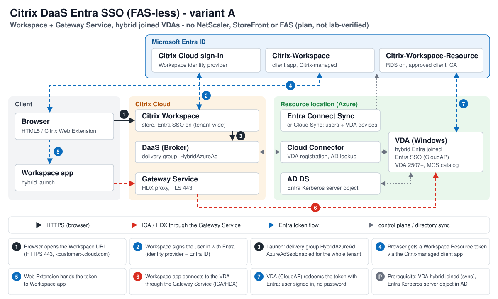

# PRD: Entra-SSO ohne FAS für Citrix DaaS

| Feld | Wert |
|---|---|
| Feature | DaaS-Variante des Repos: Entra-SSO ohne FAS mit Citrix Workspace und Gateway Service |
| Datum | 2026-10-25 |
| Status | Draft |
| Issue | [#3](https://github.com/dimi4ik/citrix-entra-sso/issues/3) |
| Grundlage | [Recherche 2026-10-25](../research/2026-10-25-daas-entra-sso.md), Quellenkürzel [Q1] usw. von dort |
| Sprache | Deutsch, als Ausnahme von der Englisch-Regel in `CLAUDE.md` (entschieden von Dima, 2026-10-25) |

## 1. Problem und Zielgruppe

Das Repo deckt nur on-prem CVAD ab und schließt DaaS ausdrücklich aus (`README.md:114`). Admins mit Citrix DaaS, im
ersten Fall Dima (DaaS Premium, Workspace mit Entra, Gateway Service, VDAs AD-joined in Azure), haben heute zwei
schlechte Wege: FAS mit eigener Zertifizierungsstelle betreiben, oder Benutzer melden sich im Desktop ein zweites Mal
an. Die on-prem-Bausteine helfen nicht direkt: StoreFront, NetScaler und die Broker-Site-Werte gibt es im Cloud-Weg so
nicht [Q1][Q3][Q8].

## 2. Ziel und Nutzen

Ein DaaS-Admin richtet mit dem Repo Entra-SSO ohne FAS in einem Durchgang ein, mit Dry-Run und Rückweg wie bisher.
Benutzer melden sich einmal mit Entra (Passkey, Windows Hello) an und landen ohne zweite Anmeldung im Desktop.

## 3. Nutzerszenarien

| Nutzer | Handlung | Ergebnis |
|---|---|---|
| Admin | führt die DaaS-Skripte mit `-WhatIf` aus | Tabelle mit `NoChange` / `WouldCreate` / `WouldUpdate`, nichts geändert |
| Admin | führt sie ohne `-WhatIf` aus | Resource-App, Conditional Access, Delivery Group und Workspace-Schalter stehen auf Soll; die alten Werte sind als Rückweg-Befehl ausgegeben |
| Admin | führt das Export-Skript aus | alle DaaS-Prüfungen `OK` oder mit klarer Ursache |
| Benutzer (Windows, Edge/Chrome) | meldet sich an Workspace an und startet einen Desktop (HTML5 und hybrid) | Desktop ohne Windows-Anmeldebildschirm |
| Benutzer (macOS, Chrome) | dasselbe | dasselbe |
| Benutzer ohne passende Gruppe / Gerät | startet einen Desktop | Conditional Access verlangt phishing-resistente MFA oder blockiert |

## 4. Varianten und Empfehlung

| Variante | Kurz | Bewertung |
|---|---|---|
| **A** Cloud-Weg, hybrid joined | Workspace (Entra) + Gateway Service + Citrix-Client-App, neuer MCS-Katalog hybrid joined, `MachineLogOnType HybridAzureAd` | **empfohlen**: AD bleibt, keine eigene Infrastruktur, Citrix und Microsoft unterstützen nicht-persistent [Q1][Q6][Q13] |
| C Cloud-Weg, Entra joined | wie A, Katalog Entra joined (nur Azure), `MachineLogOnType AzureAd` | Option für persistente, AD-freie Arbeitsplätze; Microsoft-Tabelle nennt Citrix nicht [Q7][Q13] |
| B eigener NetScaler + StoreFront | Repo nah, plus Bypass für `RedeemStoreTicket` [Q3] | nur falls mTLS Pflicht wird |
| D FAS | AD-only behalten | verworfen als Ziel, nutzbar als Übergang [Q5] |

*Eigene Zeichnung im Stil von `architecture-overview.svg`; Plan, nicht im Lab geprüft. Schritte nach [Q1][Q3][Q6].*

Das PRD beschreibt A. C unterscheidet sich nur in Katalog und `MachineLogOnType` und ist im Umfang mit abgedeckt
(Abschnitt 5, Punkt 4).

## 5. Umfang

1. Entra: RDS-Protokoll an Citrix-Workspace-Resource, Citrix-Workspace (`85651ebe-9a8e-49e4-aaf2-9274d9b6499f`) als
   approved client app, optionale Gerätegruppen (höchstens 10) [Q1][Q2][Q12]; idempotent, `-WhatIf`.
2. Entra: Prüfung, dass die beiden Citrix-Apps per Admin-Consent im Tenant sind; das Skript legt sie nicht an.
3. Conditional Access nur auf die Resource-App, wie heute [Q2].
4. Citrix: Delivery Groups auf `MachineLogOnType` `HybridAzureAd` (A) oder `AzureAd` (C) über das Remote PowerShell
   SDK [Q1]; alter Wert als Rückweg.
5. Citrix: Workspace-Schalter `AzureAdSsoEnabled` (Befehl nach Klärung von O2), mit Warnung, dass er mandantenweit
   gilt und erst nach Punkt 1 bis 4 zu setzen ist [Q1][Q4].
6. Prüfen: Export der Entra- und DaaS-Werte, dazu Voraussetzungen der VDAs (VDA ≥ 2507, Windows-Build ≥ 26100.6725
   bzw. 26100.32230) [Q1], soweit über das SDK lesbar.
7. Doku: `docs/daas.md` (Ablauf A, Rückweg, Grenzen), `README.md` Abschnitt Scope ohne den DaaS-Ausschluss,
   DaaS-Fehlerbilder in `docs/troubleshooting.md` mit Datum und getesteter Version.
8. Doku-Schritt (ohne Skript): hybrid join der Katalog-OU (Entra Connect Sync oder Cloud Sync) und
   Entra-Kerberos-Serverobjekt [Q1][Q14][Q15].

## 6. Nicht-Ziele

- Änderungen am on-prem-Weg. Die in v1.2 geprüften Skripte und NetScaler-Dateien bleiben unverändert.
- FAS einrichten.
- Variante B bauen, solange mTLS nicht als Pflicht entschieden ist (E3).
- MCS-Kataloge anlegen oder Images bauen; das bleibt in Studio oder eigener Automatisierung.
- Entra Connect / Cloud Sync installieren oder das AD verändern (nur beschrieben).
- Mehrere Citrix-Cloud-Mandanten oder Entra-Tenants.
- Entra External ID (Gäste), von Citrix nicht unterstützt [Q1].

## 7. Rahmenbedingungen und Risiken

- **Mandantenweit statt site-weit:** `AzureAdSsoEnabled` gilt für alle Stores des Citrix-Cloud-Mandanten [Q1].
  Vor der Azure-Konfiguration gesetzt, führt er zu 30-s-Starts für alle [Q1].
- **Keine eigene Client-App:** DaaS nutzt die Citrix-verwaltete App [Q3]; das Secret-Thema der on-prem-Client-App
  entfällt.
- **Anmeldung des Remote PowerShell SDK / Workspace-Moduls:** braucht einen API-Client mit Secret
  (`-ClientId`/`-ClientSecret` [Q4]). Nach Repo-Regel nur über `${env:NAME}` oder maskierte Eingabe.
- **Katalog:** Identität AD → hybrid laut Community nicht umstellbar, Neubau nötig [Q19] (O5).
- **Join-Verzögerung:** bis 30 Minuten beim ersten Start [Q6]; veraltete Geräteobjekte bei nicht-persistenten
  Maschinen aufräumen [Q13].
- **Privilegierte Konten:** kein SSO auf hybrid joined VDAs ohne RODC-Freigabe [Q1].
- **Bekannte Brecher:** Intune-Baseline (LSASS Custom SSPs), Richtlinie „Auto client reconnect authentication“,
  KMSI aus (Mac/Linux) [Q1][Q17].
- **Rechte:** Cloud Application Administrator (Entra), Conditional Access Administrator, Citrix-Cloud-Admin mit
  Rechten auf Delivery Groups und Workspace-Konfiguration [Q11][Q16].
- **Lab:** Prüfung nur gegen Dimas echten DaaS-Mandanten möglich; macOS-Rechner prüft nur Syntax.

## 8. Erfolgskriterien

Für die spätere Umsetzung, im Lab gegen DaaS geprüft:

1. HTML5- und Hybrid-Start (Windows 11 Edge und Chrome mit Web Extension, macOS Chrome) auf einem hybrid joined VDA:
   Desktop ohne Windows-Anmeldebildschirm, je 3 Starts von 3 erfolgreich.
2. Zeit vom Klick bis zum Desktop höchstens 20 s (on-prem-Referenz ~10 s, Fehlerbild ≥ 30 s).
3. Entra-Anmeldeprotokoll zeigt je Start eine Anfrage für Citrix-Workspace-Resource über Citrix-Workspace.
4. Jedes neue oder geänderte Skript läuft mit `-WhatIf` ohne Änderung; ein zweiter Lauf ohne `-WhatIf` meldet nur
   `NoChange`.
5. Syntaxprüfung aus `CLAUDE.md`: `0` Fehler je Datei.
6. Export-Skript: alle DaaS-Prüfungen `OK`.
7. Rückweg dokumentiert und einmal ausgeführt: danach wieder Windows-Anmeldung bzw. FAS-Weg wie vorher.
8. Keine echten Namen, IDs oder Secrets in Commits (Release-Check aus `docs/release.md`).

## 9. Dateien: bleibt / ändert sich / entfällt / neu

„Entfällt“ heißt: im DaaS-Weg (A, C) nicht gebraucht. Gelöscht wird nichts, der on-prem-Weg bleibt (Nicht-Ziel).

| Datei | Für DaaS | Begründung |
|---|---|---|
| `scripts/New-EntraSsoClientApp.ps1` | entfällt | legt die eigene Client-App, Redirect-URIs und Secret an; DaaS nutzt die Citrix-verwaltete App [Q3]. Der darin enthaltene Resource-App-Teil (RDS, approved client) wandert für DaaS ins neue Skript, damit der geprüfte on-prem-Lauf unberührt bleibt (E2) |
| `scripts/New-EntraSsoConditionalAccess.ps1` | ändert sich (klein) | bleibt nutzbar mit `applications: ["resource"]`; die Option `client` zeigt in DaaS auf eine Citrix-App, die Citrix ausdrücklich ausnimmt [Q2]. Warnung oder Sperre bei DaaS |
| `scripts/Set-BrokerSiteEntraSso.ps1` | entfällt | `AzureSSOn*` ist in der DaaS-SDK nicht dokumentiert [Q8]; Steuerung über Workspace-Schalter und Delivery Group [Q1] (O1) |
| `scripts/Set-StoreFrontEntraSso.ps1` | entfällt | kein StoreFront im Cloud-Weg; nur bei Variante B wieder nötig [Q3] |
| `scripts/Export-EntraSsoConfig.ps1` | ändert sich | Entra-Prüfungen bleiben, aber „approved client“ gegen Citrix-Workspace statt `clientAppId`; Broker- und StoreFront-Teil durch DaaS-Teil ersetzen (Delivery Group `MachineLogOnType`, Workspace-Schalter, VDA-Version/Build) |
| `scripts/Enroll-YubiKeyPiv.ps1` | bleibt (ungenutzt) | nur für mTLS am eigenen NetScaler; im Cloud-Weg ohne Verwendung (E3) |
| `netscaler/09-entra-sso-gateway-cert.json` | entfällt | Gateway Service statt eigener NetScaler |
| `netscaler/10-entra-sso-aaa.json` | entfällt | OIDC zu Entra macht Workspace selbst [Q1] |
| `netscaler/11-entra-sso-gateway.json` | entfällt | kein eigener Gateway-vServer, kein Token-Rewrite |
| `netscaler/12-entra-sso-mtls-certs.json` | entfällt | mTLS nur bei B |
| `netscaler/12-entra-sso-mtls.json` | entfällt | mTLS nur bei B |
| `netscaler/13-client-crl.cli` | entfällt | mTLS nur bei B |
| `pki/step-ca-client/ca.json.example` | bleibt (ungenutzt) | Client-CA nur für mTLS bei B |
| `pki/step-ca-client/client-auth.tpl` | bleibt (ungenutzt) | wie oben |
| `pki/step-ca-client/compose.override.example.yml` | bleibt (ungenutzt) | wie oben |
| `pki/step-ca-client/nginx-client-crl.conf` | bleibt (ungenutzt) | wie oben |
| `config/example.json` | bleibt | on-prem-Layout unverändert; eine Änderung wäre laut `CLAUDE.md` ein Major-Bruch. DaaS bekommt eine eigene Beispieldatei (E4) |
| `config/example-daas.json` | neu | `tenantId`, `resourceAppId`, `citrixClientAppId` (`85651ebe-…`), `customerId`, `deliveryGroups`, `machineLogOnType`, `targetDeviceGroups`, `conditionalAccess`, Name der Umgebungsvariable für das API-Client-Secret |
| `scripts/Set-EntraSsoResourceApp.ps1` (Name vorläufig) | neu | RDS-Protokoll, Citrix-Workspace als approved client, Gerätegruppen, Prüfung der Admin-Consents; Graph nur über `Invoke-MgGraphRequest` |
| `scripts/Set-DaasEntraSso.ps1` (Name vorläufig) | neu | Delivery Groups `MachineLogOnType`, Workspace-Schalter `AzureAdSsoEnabled` als letzter Schritt, Rückweg-Ausgabe |
| `netscaler/14-redeemstoreticket-bypass.json` | neu, nur bei B | Content Switching am Gateway vorbei für `/Citrix/<StoreWeb>/Tickets/RedeemStoreTicket` [Q3]; nicht im Umfang, solange E3 offen |

## 10. Entscheidungen

| # | Frage | Optionen | Empfehlung | Entschieden (Dima, 2026-10-25) |
|---|---|---|---|---|
| E1 | Variante A oder C? | A hybrid joined / C Entra joined / beides | **A**, solange Apps AD brauchen oder Kataloge nicht-persistent sind; hängt an O6 (persistent?) | **A**; Kataloge sind nicht-persistent (O6) |
| E2 | Resource-App-Teil: neues Skript oder Modus in `New-EntraSsoClientApp.ps1`? | neues Skript / Parameter im alten Skript | **neues Skript**: der in v1.2 geprüfte on-prem-Lauf bleibt unberührt, keine Neuvalidierung | **neues Skript** |
| E3 | Ist mTLS Pflicht? | nein, Conditional Access reicht / ja → Variante B / erst klären (O3) | **erst O3 klären**; bis dahin phishing-resistente MFA per Conditional Access auf die Resource-App | **erst O3 klären** ([#6](https://github.com/dimi4ik/citrix-entra-sso/issues/6)), bis dahin Conditional Access |
| E4 | Config: eigene Datei oder `example.json` erweitern? | `example-daas.json` / gemeinsames Layout mit `platform` | **eigene Datei**: kein Major-Bruch, Skripte bleiben getrennt lesbar | **`config/example-daas.json`** |
| E5 | DaaS im selben Repo oder eigenem? | selbes Repo (Fork) / eigenes Repo / Vorschlag an Upstream | **selbes Repo**, Entra-Teil und Doku werden geteilt; ob es an Upstream geht, entscheidet Dima | **in diesem Fork** |

O6 ist beantwortet (nicht-persistent). Die übrigen offenen Fragen aus der Recherche bleiben bestehen; O1 (`Get-BrokerSite` im eigenen Mandanten) und O2
(Store-Befehl) blockieren Punkt 5 und 6 des Umfangs und kommen vor der Umsetzung.

## 11. Bezug

- Issue [#3](https://github.com/dimi4ik/citrix-entra-sso/issues/3) mit Akzeptanzkriterien
- Angaben zur Umgebung: Dima, 2026-10-25 (Rückfragen in der Planungssitzung)
- [Recherche](../research/2026-10-25-daas-entra-sso.md) mit Quellen Q1 bis Q22
- `README.md:61-115` (site-weite Grenze, Scope), `docs/architecture.md`, `docs/deployment.md`,
  `docs/troubleshooting.md`, `config/example.json`, Köpfe aller Skripte in `scripts/`
